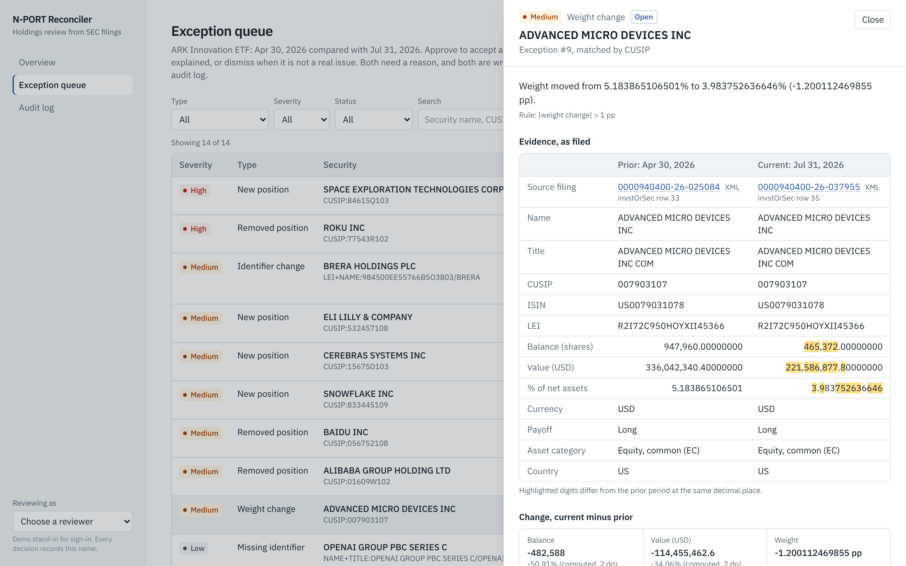
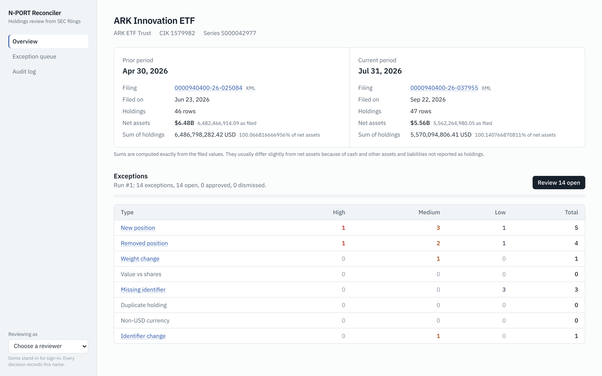
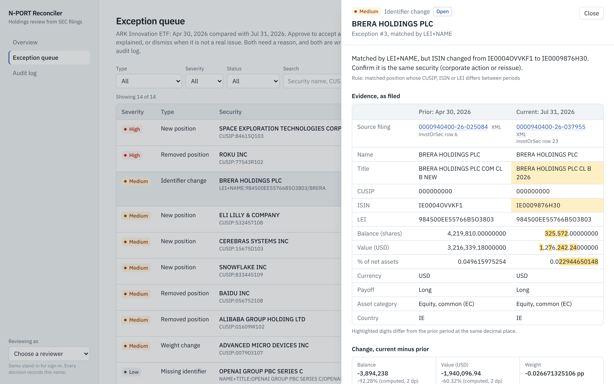
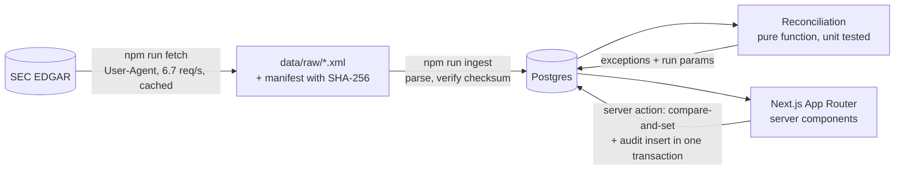

# N-PORT Reconciler

Pulls an ETF's public N-PORT filings from SEC EDGAR, reconciles holdings between two filing periods, surfaces exceptions, and routes each one through a review queue with a permanent audit trail: what changed, who decided, when, and why.

**Live demo:** https://nport-reconciler.vercel.app

**Walkthrough video (78 seconds):** [docs/walkthrough.mp4](docs/walkthrough.mp4)

The demo fund is **ARK Innovation ETF (ARKK)**, a series of ARK ETF Trust (CIK 1579982). Every number in the app comes from its real NPORT-P filings, and every holding links back to the exact filing and row it came from.



## What it found in ARKK (Apr 30, 2026 vs Jul 31, 2026)

Run against filings 0000940400-26-025084 and 0000940400-26-037955: 46 and 47 holdings, 42 positions matched, 14 exceptions. Among them:

- **New positions:** Space Exploration Technologies Corp at 4.87% of net assets, Cerebras Systems at 1.79%, plus Snowflake, Eli Lilly and Alphabet.
- **Exits:** Roku (4.33% of net assets in April), Baidu, Alibaba and Figma.
- **Weight change:** Advanced Micro Devices fell from 5.18% to 3.98%, with shares down 50.91%.
- **Identifier change:** Brera Holdings PLC kept its LEI and name, but its ISIN changed from IE0004OVVKF1 to IE0009876H30, its title changed, and its share count fell 92%. The app matches it as the same position and asks a reviewer to confirm the corporate action. This check was added after the first run on real data showed the gap.
- **Missing identifiers:** OpenAI Group PBC Series C, a Goldman Sachs treasury money market fund, and Brera warrants are filed with CUSIP `000000000` and no ISIN.

Every figure was checked against the raw XML with an independent script (Python `Decimal`), including the exact sum of market values.

| Overview | Identifier change |
|---|---|
|  |  |

## Why this exists

ETF operations teams reconcile holdings, prices and vendor files every day. The hard part is not computing a diff. It is making every difference explainable, reviewable and attributable, so nothing changes without a reason on record. This project is a small, working slice of that workflow built on public data.

| What an ETF issuer needs | What this demo does |
|---|---|
| Ingest holdings files, reconcile data, surface exceptions | Fetches and parses NPORT-P XML from EDGAR, reconciles two periods, generates typed exceptions with severity |
| Guardrails around data provenance, versioning and reconciliation so changes are explainable and reviewable | Every holding stores its CIK, series ID, accession number, report period, filing URL, row position and the SHA-256 of the source file. Ingest is idempotent and verifies checksums |
| Exception queues and operational tooling so issues are visible, triaged and resolved | Queue with type, severity, status and text filters, shareable URLs, and an evidence drawer that shows both periods side by side |
| Permissioned workflows with evidence capture (what changed, who approved, when, and why) | Approve, dismiss and reopen all require a reviewer and a written reason. Status changes are compare-and-set, so two reviewers cannot both win |
| An append-only record | A Postgres trigger rejects UPDATE, DELETE and TRUNCATE on the audit log, and a CHECK constraint rejects any decision without a reason. It is enforced by the database, not just the app |
| Sweat the details: loading, empty and error states | Every page has skeleton loading, a useful empty state, and an error state with a retry |

## What it checks

Positions are matched across periods by the best available identifier, in order: **CUSIP**, then **ISIN**, then **LEI + issuer name**, then **name + title** as a last resort. A key that matches more than one candidate is never guessed; both sides become exceptions instead. The match method is recorded on every exception so a reviewer can judge its confidence.

| Exception | Rule (defaults, stored with each run) | Severity |
|---|---|---|
| New position | In the current period, no match in the prior | By weight: high at 2% or more, medium at 0.5% or more |
| Removed position | In the prior period, no match in the current | Same as above, using the prior weight |
| Weight change | Weight moved more than 1 percentage point | High above 3 pp |
| Value vs shares | Shares flat (within 0.5%) but value moved 50% or more, or shares moved 10% or more but value flat; also a nonzero balance with zero value | Medium, high for extreme moves |
| Missing identifier | No valid CUSIP or ISIN (placeholders like `N/A` and `000000000` are treated as missing) | Low |
| Duplicate holding | More than one row with the same identifier and payoff profile | Medium |
| Non-USD currency | Currency code other than USD | Low |
| Identifier change | A matched position whose CUSIP, ISIN or LEI differs between periods | Medium |

## Correctness choices

- **No floating point on filed values.** Numbers are stored as Postgres `numeric` and handled as strings. Differences and sums use exact decimal arithmetic on `BigInt`. Only percent changes are rounded, and the UI labels them as computed.
- **Shown as filed.** The evidence drawer shows the raw strings, including trailing zeros, and highlights the digits that changed from the prior period. Tables trim trailing zeros, which never changes a value.
- **Duplicates are summed exactly**, and the drawer lists each underlying row.
- **Raw source kept.** Each holding keeps the full parsed `<invstOrSec>` element as JSON, viewable in the drawer.

## Architecture



| Path | What it is |
|---|---|
| `scripts/fetch-filings.mjs` | Zero-dependency EDGAR client. Finds the series' latest NPORT-P filings, caches XML, writes a manifest with checksums |
| `scripts/ingest.ts` | Loads the manifest into Postgres with provenance, then runs reconciliation. Safe to re-run |
| `src/lib/nport-parser.ts` | NPORT-P XML parser. Keeps every value as the filed string |
| `src/lib/reconcile.ts` | Matching and exception rules. No I/O |
| `src/lib/decimal.ts` | Exact decimal math |
| `src/db/schema.ts`, `drizzle/` | Drizzle schema and migrations, including the append-only trigger |
| `src/server/actions.ts` | Approve, dismiss and reopen |
| `src/app/` | Overview, exception queue, audit log |

Stack: Next.js 16 (App Router, Cache Components), React 19, TypeScript, Drizzle ORM, Postgres, Tailwind 4, Vitest.

## Run it locally

Requires Node 20 or newer. No Postgres install needed: local development uses PGlite, an embedded Postgres served on port 5433.

```bash
npm install
cp .env.example .env.local        # SEC_USER_AGENT is only needed for npm run fetch

npm run db:local                  # terminal 1: starts the local database (data kept in ./.pglite)

npm run db:migrate                # terminal 2
npm run ingest                    # loads the cached filings in data/raw and runs the reconciliation
npm run dev                       # http://localhost:3000
```

The two ARKK filings are committed in `data/raw` with their SHA-256 checksums, so the app runs without network access. To pull newer filings, run `npm run fetch` first (it needs `SEC_USER_AGENT` set).

Run the tests with `npm test`.

To track a different fund, edit `fund.config.json` (CIK plus series name or series ID). `node scripts/fetch-filings.mjs --list` prints every series a trust files for.

## Deploy

1. Create a Postgres database (Neon, PlanetScale Postgres, Supabase).
2. Import the repo in Vercel and set `DATABASE_URL`.
3. Deploy. The `vercel-build` script runs the migrations and loads the committed filings before building, so the database is ready on the first deploy. Re-running is safe: ingest skips filings already loaded and never touches reviewer decisions. The deployed app never calls EDGAR.

## Data source notes

- **Form NPORT-P** is the public version of Form N-PORT, which registered funds use to report portfolio holdings. The file used here is the `primary_doc.xml` in each filing's EDGAR folder.
- Filings are found through `https://data.sec.gov/submissions/CIK##########.json`. A trust files one NPORT-P per series, so the fetcher reads each filing's `<seriesName>` and `<seriesId>` and keeps only the target fund.
- ARK ETF Trust files NPORT-P quarterly, for periods ending in January, April, July and October, about 50 to 60 days after period end.
- `repPdDate` is the report date used as the period. `repPdEnd` is the fund's fiscal year end, not the period end.
- SEC fair access rules: requests carry a descriptive `User-Agent` with contact details and stay under 10 per second. Downloads are cached and never re-fetched.
- Holdings do not sum exactly to net assets; cash, receivables and liabilities sit outside the holdings list. The overview shows both so the gap is visible.

## Design decisions

- **Reviewer selector instead of sign-in.** A deliberate stand-in to keep the demo focused. Every decision still records a named actor; real auth and role-based permissions are the first thing on the list below.
- **Exceptions are tied to a run.** Re-running ingest never overwrites decisions. A new pair of filings produces a new run.
- **Text with CHECK constraints rather than Postgres enums** for type, severity, status and audit action. Same guarantees, simpler migrations.

## What I would build next

- **Real auth and permissions:** SSO, reviewer and approver roles, and four-eyes approval for high-severity exceptions.
- **Vendor feeds over SFTP:** reconcile custodian and index-provider files against the fund's own books, not just filing against filing.
- **Scheduled ingestion with retries:** poll EDGAR for new filings, retry with backoff, alert on failures, and reconcile automatically.
- **iXBRL and other forms:** N-CSR financial statements and prospectus risk/return data, linked to the same provenance model.
- **Explained exceptions:** an LLM drafts a plain-English explanation for each exception from the evidence; a human still decides, and the draft is stored alongside the decision.
- **Exports:** CSV of exceptions and the audit log for compliance files.
